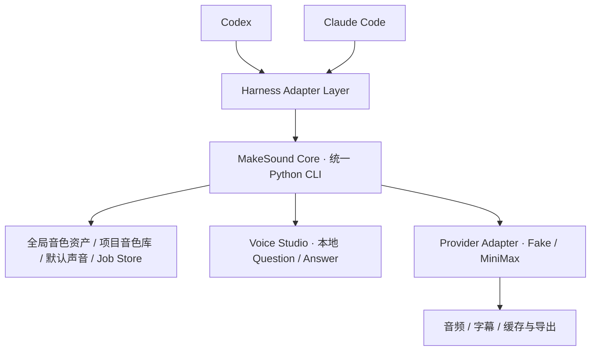

# MakeSoundSkill V1.2 — Harness Adapter 设计

日期：2026-10-14（Asia/Shanghai）。状态：核心 CLI/数据已在 M1 实现并通过离线测试；宿主安装与平台对话仍 NOT RUN。最新结果见 [M1_Implementation_Report.md](M1_Implementation_Report.md)。

## 1. 产品确认与证据等级

**Product-Confirmed（最新用户决定）**：V1.2 只验收 Codex、Claude Code。核心 Harness-Agnostic，不为 Kimi、DSH、WorkBuddy 或豆包开发 Adapter。下文 Kimi Work 设计与 KW 相关内容仅是未来扩展存档；kimi_work 与 kimi_code 仍须区分，但不影响当前交付。

**Docs-Verified**：官方 Kimi Work 介绍确认 Windows 本地 Agent、上传本地 Skills、本地文件/浏览器工具及运行代码的权限控制。[产品介绍](https://www.kimi.com/help/kimi-work/overview)。官方另有自定义插件创建说明，不能据此断言自有 Skill 已安装或 MakeSound CLI 已执行。[个人插件](https://www.kimi.com/en/help/plugins-and-skills/create)

**Observed**：此前仅在本机开始菜单找到“Kimi”条目；未打开客户端，未核验其版本、Work 模式或授权。Python/FFmpeg 等环境记录见 [M0 报告](M0_Discovery_Report.md)。此前 Kimi Code CLI 的超时和 session 文档不构成 Kimi Work 的实测证据。

**Proposed**：下文为待实现设计。**NOT RUN**：Skill 安装/触发、本机 Python 调用、Studio、网页回答、手动恢复、权限与并发测试全部未执行。本轮不安装插件、不运行平台模型任务、不尝试向原聊天发消息，不调用真实 MiniMax。

## 2. 统一架构

Adapter 只处理 Skill 包装与安装指引、宿主执行方式、可信项目上下文、权限反馈、真实 URL 展示、短轮询与恢复指令。Core 负责声音解析、Schema/覆盖、资产与别名、快照、任务状态、幂等、缓存、字幕、拼接及 Provider 调用；所有平台使用相同代码和数据格式。

如果未来重新启动 Kimi Work 适配，采用本地 Skill + 同一 Python CLI 的存档方案，不要求安装 Kimi Code CLI；本版不实施。MCP/Plugin 属可选扩展，不建立公网 MCP，不重写 MiniMax/字幕服务。

## 3. Adapter 上下文草图

以下字段是产品内部草图，不是 Kimi 原生 API；不得把 capability 值预置为已验证支持。

| 字段 | 语义 |
|---|---|
| platform_id | V1.2 仅 codex / claude_code；未来扩展标识独立，不在本次实现 |
| client_product / client_version / mode | 实际产品、版本与 Work 模式；未核实为 unknown |
| execution_location | 本机/云端/unknown；本机可用性需测试，不能仅凭品牌推断 |
| project_root / root_source | 明确用户目录或可靠宿主 workspace；不能盲用 cwd/HOME |
| interpreter / shell_dialect | 真实 Python 与宿主 Shell；Kimi Work 不默认继承 Git Bash |
| permission_mode | 实际审批模式；拒绝/取消不能标成功，不自动切全权限 |
| native_session_ref | 可选、宿主提供且可靠才记录；缺失不阻碍手动恢复 MakeSound Job |
| wait_strategy / observed_wait_limit | 短轮询/等待；限时未知保持 unknown，不继承 Kimi Code 的 60s/5min |
| resume_transport | 基础 manual_instruction；其他协议仅在单独验证后启用 |
| evidence | 每项区分 Docs-Verified、Observed、NOT RUN，记录日期与版本 |

核心操作沿用 PRD 的 config resolve、studio start/wait/answer get、jobs status/resume 等 CLI；均是**目标契约，当前未实现**。参数使用实际返回 ID 和绝对路径，不从网页拼接任意命令或运行用户输入的可执行内容。

## 4. 统一 Question / Answer / ResumeIntent

各平台共用 [Testing_Plan.md](Testing_Plan.md) 的 Schema 草图，协议所有者是 Core，宿主内部 session 只是可选关联。

| 对象 | 关键关联/不变量 |
|---|---|
| Question | question_id、job_id、project_id、purpose、expected_revision、expires_at；关联本次配置交易，不保存声音 Session Preference |
| Answer | answer_id、question_id、job_id、project_id、selection、save_intents、revision；明确应用后原子保存，重复提交幂等 |
| ResumeIntent | resume_intent_id、job_id、question_id、answer_id、snapshot_hash（若已有）、target_platform、可选 native_session_ref、lease、status；重发不产生第二次调度 |

未生成快照的 setup Job 在回答成功应用并完成文本/配置校验后冻结快照；已有快照的 Job 续跑不重解析已变更别名/默认。回答有保存默认意图不等于有生成授权。任何账单结果未知的尝试保持 billing_unknown，不由恢复按钮自动重发。

### 4.1 正常等待

1. 用户在 Kimi Work 要求配音；Skill 提取已确认文稿和可信项目根，调用统一 CLI 解析配置。
2. 缺声音时 Core 创建或关联 Job/Question，实际启动回环 Studio，返回真实 URL/ID；地址可达后才报告就绪。
3. 用户在本地网页提交 Answer；Core 校验项目、问题、TTL、revision 和保存意图，持久记录。
4. 宿主仍在等待时，短 wait 返回已应用答案；Agent 按同一 Job 继续，Fake 测试不得触达 MiniMax。

短 wait 时长必须可配置，首轮桌面测试采用有界短等待；具体值是测试参数，不是已知宿主上限。轮询有总预算和取消处理，避免无界循环消耗 Agent 额度。wait 超时只是本次等待结束，不等于 Question 过期。

### 4.2 等待已结束

Answer 保存在本机。页面提示“回答已保存，待继续”，提供可复制的“继续配音任务，任务 ID：<实际 job_id>”。用户在 Kimi Work 再次发送，Skill 根据明确 job_id 读取 status/answer 并恢复同一 Job；不要求专有会话恢复 API，也不将用户带入另一个随机任务。

缺失/歧义 job_id 时展示受当前项目限制的待续任务供选择，不能取全局“最近一个”猜测。新聊天只要用户明确指定可访问 Job，也能恢复 MakeSound 状态；这不证明恢复了原 Kimi 会话上下文。生成所需源文、配置和状态必须在 Job Store 中可恢复。

问题已过 TTL、取消、revision 冲突、授权不足需要处理后再继续；已完成 Job 返回现有产物，正在运行返回当前状态；双击、重复发送和进程崩溃不会重复领取/生成。没有真实文件或运行器接管证据，不显示 completed 或“Agent 已继续”。

### 4.3 可选自动恢复

Kimi Work 向特定原聊天投递消息、原会话恢复协议尚未验证。本阶段仅调查公开依据，**不发送测试消息、不配置桥接**。未来有正式、可验证的接口后才能启用可选 transport；当前 manual_instruction 保持有效，不为自动桥接引入公网服务。

## 5. 安装、项目与权限边界

- 使用同一 MakeSoundSkill 内容与脚本，仅宿主安装说明/包装不同。Kimi Work 本地上传支持有文档依据，但该版本接受的文件夹/压缩包格式、安装目录、脚本资源解析须在 KW-02 记录；不能沿用 `.kimi-code` 或 CLI Skill 路径。
- KW-03 验证真实 Windows Python 可由桌面工具调用，路径带空格/中文、stdout JSON/退出码正确；宿主自带执行环境不能冒充系统解释器。
- KW-04 验证明确的测试项目根与项目音色数据，拒绝越界。样本、Key、业务源文不写入 Skill 包或项目音色配置。
- 按用户现有审批模式测试；拒绝、取消、权限不足或只读路径不写入、不回落到其他目录、不偷偷切全权限。
- Studio 仅 127.0.0.1、随机端口、随机令牌、TTL、Origin/CSRF 与路径限制；浏览器工具有文档依据不等于真实 localhost 访问已通过。

## 6. 验收与本轮停止点

Kimi Work 用 KW-01 至 KW-10 实机验收，替代旧 Kimi Code 用例。Codex/Claude/DSH 也必须执行相同 Core 问答/恢复/数据隔离契约；宿主恢复命令存在不替代 MakeSound Job 验收。

本轮仅文档修订。先完成 Core/Fake Provider/CLI/Studio 的相应里程碑，再在真实 Kimi Work 做“读取 Skill → 无收费 CLI → 真实 Studio → 网页提交 → 同 Job 继续/手动恢复”的最小闭环。平台模型额度与 MiniMax 费用分别记录；Fake 只保证不调用 MiniMax。阶段安排见 [Platform_Integration_Plan.md](Platform_Integration_Plan.md)。
